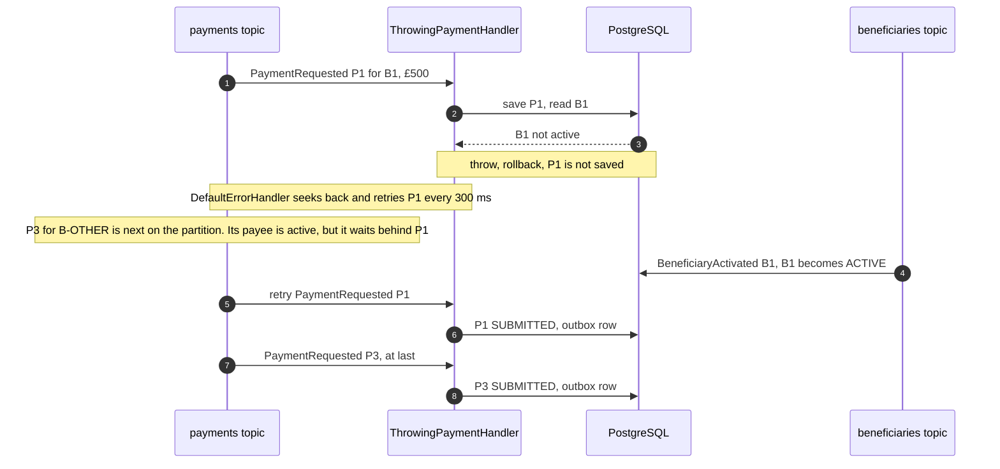
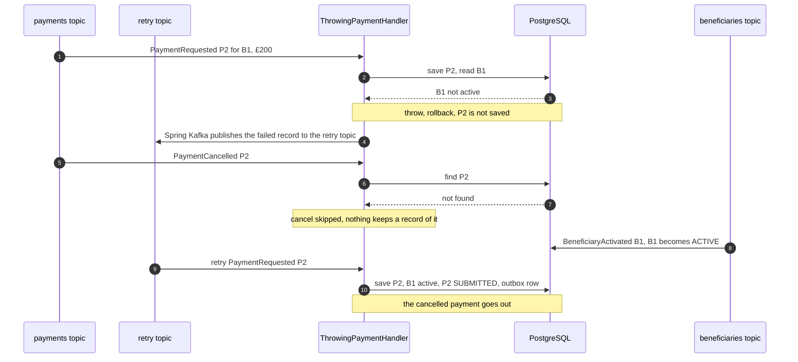
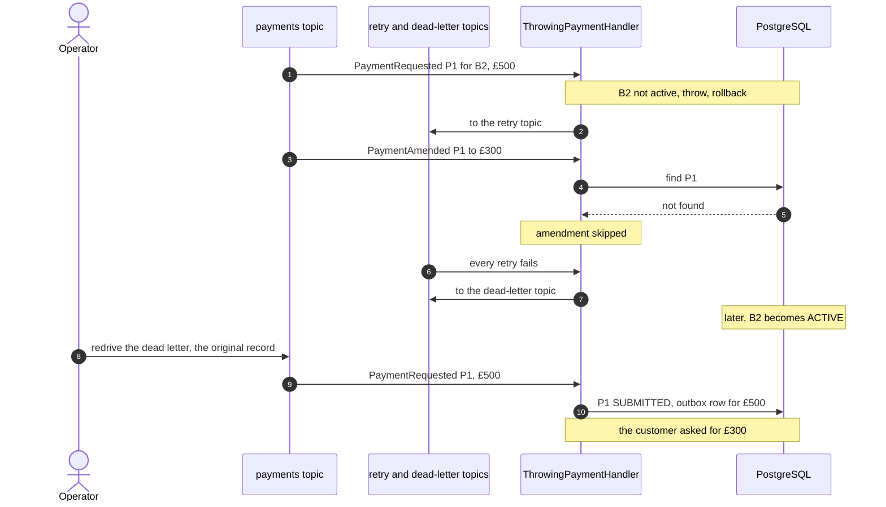
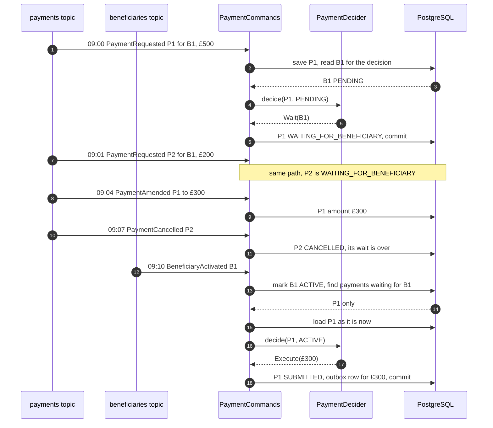
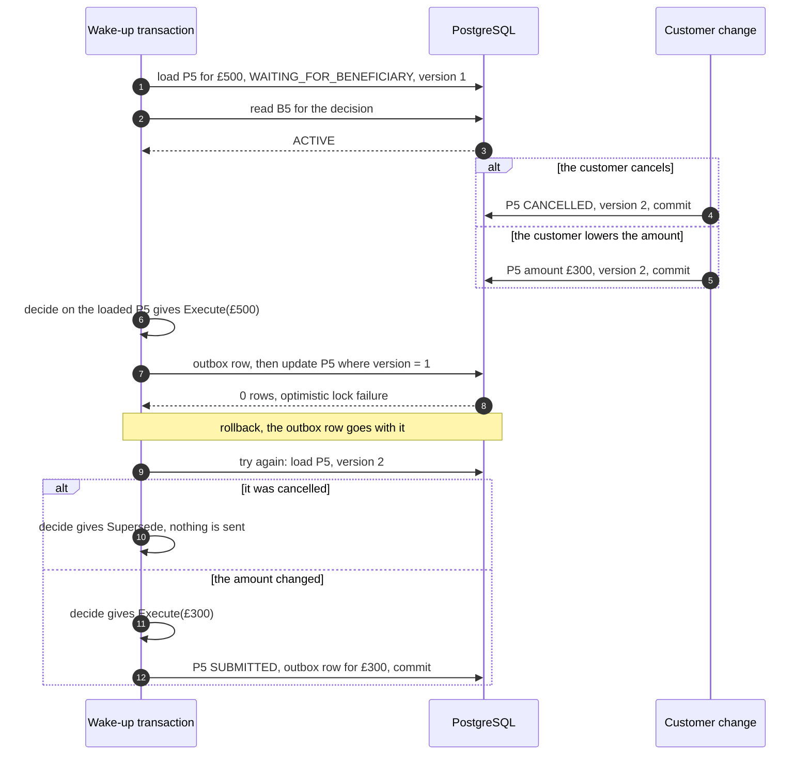
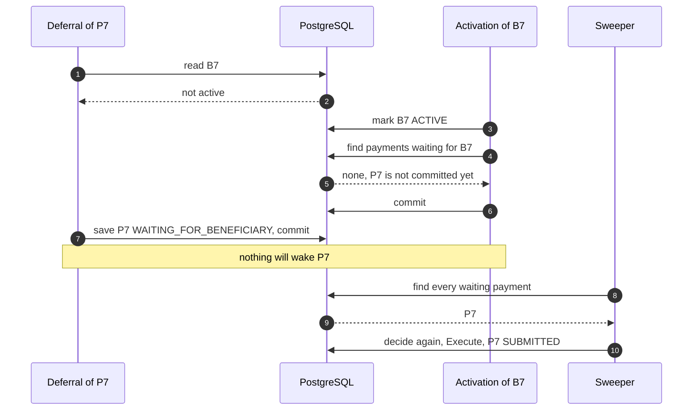
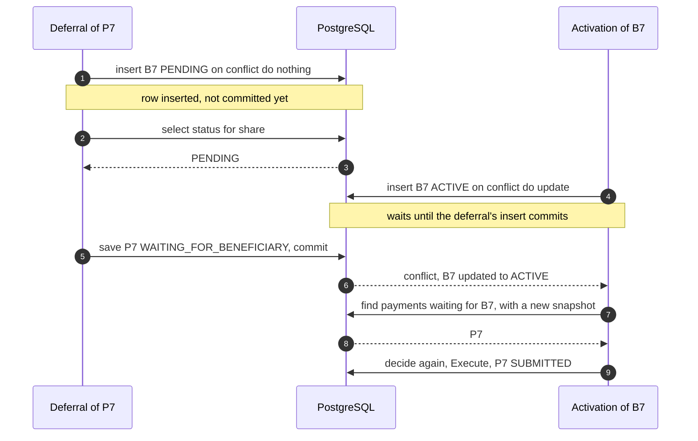
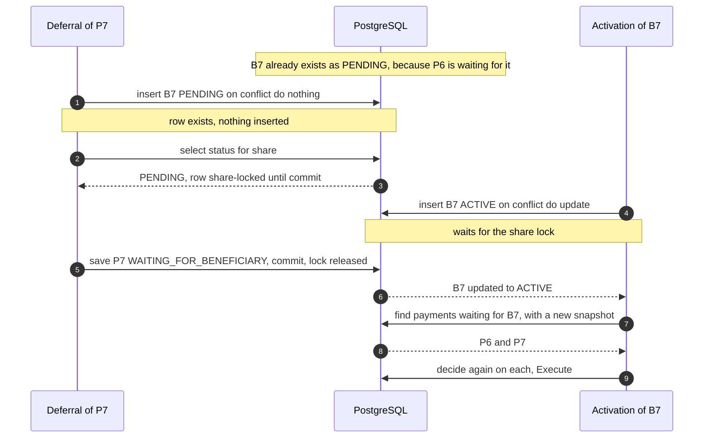

# Don't Replay It, Re-decide It

[](https://github.com/elgamal-ahmed/kafka-deferred-work-recovery/actions/workflows/ci.yml)

Demo code for the talk *Don't Replay It, Re-decide It: Recovering Deferred Work in Kafka and Java*.

A customer adds a new payee and pays them straight away. The payee is still being verified, so the
payment service has to hold the payment until a `BeneficiaryActivated` event arrives on another topic.
Kafka gives no ordering between the two topics.

This repository shows two common ways of handling that with Spring Kafka retries, what goes wrong with
each, and a different model:

> A missing business precondition that can be satisfied later is not a failed execution.
> Store the wait as domain state, wake it on the event that matters, and re-run the domain
> decision against current state instead of replaying the original message.

Every scenario from the talk is a test that runs against real Kafka and PostgreSQL (Testcontainers).
The waiting design's races are reproduced with controlled thread interleaving, so those tests are
deterministic. The retry scenarios depend on the configured backoff, so each of those test classes
sets its own retry settings.

## The scenarios

| # | Scenario | Test |
|---|----------|------|
| 1 | Blocking retry keeps partition order by stopping every later record on the partition | [`BlockingRetryTest`](src/test/java/com/elgamal/payments/throwing/BlockingRetryTest.java) |
| 2a | `@RetryableTopic` keeps the partition moving, so a cancel overtakes the retried request, finds nothing, and the cancelled payment is later submitted | [`NonBlockingRetryTest`](src/test/java/com/elgamal/payments/throwing/NonBlockingRetryTest.java) |
| 2b | The amendment overtakes the retried request and is dropped. Once the retries run out, redriving the dead letter replays the original record: £500 is sent, not the amended £300 | [`DeadLetterRedriveTest`](src/test/java/com/elgamal/payments/throwing/DeadLetterRedriveTest.java) |
| 3a | Wait as domain state: the cancel and the amendment both have a payment to act on, and activation decides again against current state | [`WaitingPaymentTest`](src/test/java/com/elgamal/payments/waiting/WaitingPaymentTest.java) |
| 3b | A cancel commits after a wake-up loaded the payment: the `@Version` check fails, the payment is reloaded, and the decision becomes `Supersede` | [`WaitingPaymentTest`](src/test/java/com/elgamal/payments/waiting/WaitingPaymentTest.java) |
| 3c | An amendment commits after a wake-up loaded the payment: the stale `Execute` and its outbox row roll back, the payment is reloaded, and £300 is sent | [`WaitingPaymentTest`](src/test/java/com/elgamal/payments/waiting/WaitingPaymentTest.java) |
| 4a | The lost wakeup: activation commits between "read: not active" and "save: waiting", and the payment is never woken (until the sweeper runs) | [`LostWakeupTest`](src/test/java/com/elgamal/payments/waiting/LostWakeupTest.java) |
| 4b | The fix, for a beneficiary we have never seen: the deferral inserts the beneficiary row, so activation waits for that insert to commit and then finds the waiting payment | [`LostWakeupFixedTest`](src/test/java/com/elgamal/payments/waiting/LostWakeupFixedTest.java) |
| 4c | The fix, for a beneficiary that is already pending: the deferral share-locks the row, so activation waits for the lock and then finds the waiting payment | [`LostWakeupFixedTest`](src/test/java/com/elgamal/payments/waiting/LostWakeupFixedTest.java) |

Why not retry the amendment or the cancel as well? In the throwing designs a payment is only committed
once it has been submitted, so a retried cancel would still never find an open payment to act on.

The decision itself is a pure function with its own unit test:
[`PaymentDeciderTest`](src/test/java/com/elgamal/payments/waiting/PaymentDeciderTest.java).

## Sequence diagrams

Each diagram follows one of the tests above. Kafka listeners are left out where they only pass the
event on: `WaitingPaymentListener` and `BeneficiaryListener` hand events straight to
`PaymentCommands`, and the throwing listeners hand them to `ThrowingPaymentHandler`.

### The throwing designs

**1. Blocking retry stops the partition** ([`BlockingRetryTest`](src/test/java/com/elgamal/payments/throwing/BlockingRetryTest.java))



**2a. With `@RetryableTopic`, the cancel overtakes the request and is lost** ([`NonBlockingRetryTest`](src/test/java/com/elgamal/payments/throwing/NonBlockingRetryTest.java))



**2b. Redriving a dead letter sends the old amount** ([`DeadLetterRedriveTest`](src/test/java/com/elgamal/payments/throwing/DeadLetterRedriveTest.java))



### The waiting design

**3a. Wait as state, decide again on wake-up** ([`WaitingPaymentTest`](src/test/java/com/elgamal/payments/waiting/WaitingPaymentTest.java))



### Corner cases

**3b and 3c. A customer change lands while a wake-up is deciding** ([`WaitingPaymentTest`](src/test/java/com/elgamal/payments/waiting/WaitingPaymentTest.java))



**4a. The lost wakeup, without the lock** ([`LostWakeupTest`](src/test/java/com/elgamal/payments/waiting/LostWakeupTest.java))



**4b. The fix, for a beneficiary we have never seen** ([`LostWakeupFixedTest`](src/test/java/com/elgamal/payments/waiting/LostWakeupFixedTest.java))



**4c. The fix, for a beneficiary that is already pending** ([`LostWakeupFixedTest`](src/test/java/com/elgamal/payments/waiting/LostWakeupFixedTest.java))



Both fixes rely on READ COMMITTED, where the select after the upsert takes a new snapshot. Under
REPEATABLE READ the first case fails with a serialization error, and the second silently misses P7.

## The model

```java
public sealed interface Decision {
    record Execute(BigDecimal amount) implements Decision {}
    record Wait(String beneficiaryId) implements Decision {}
    record Supersede(String reason) implements Decision {}
}
```

- **Don't throw for a missing precondition.** The request and its waiting state commit together.
  The listener only throws for technical failures, and those stay with the retry infrastructure.
- **One decision function**, [`PaymentDecider.decide(payment, beneficiary)`](src/main/java/com/elgamal/payments/waiting/PaymentDecider.java),
  runs on first delivery and on every wake-up. The decision is applied with an exhaustive switch in
  [`PaymentCommands`](src/main/java/com/elgamal/payments/waiting/PaymentCommands.java), so the compiler
  checks that every case is handled.
- **Waiting is explicit state** (`WAITING_FOR_BENEFICIARY`), indexed by `beneficiary_id` so the waking
  event can find it.
- **Wake on the event, sweep as a backstop.** The sweeper decides again on every waiting payment on a
  schedule, in case a wake-up was missed.
- **Saving the wait and waking it must not interleave unsafely.** See
  [`BeneficiaryProjection.readForDecision`](src/main/java/com/elgamal/payments/beneficiary/BeneficiaryProjection.java).
  The fix relies on PostgreSQL's READ COMMITTED isolation, which the application sets explicitly.
- **Execution** changes the payment state and writes an outbox row in one transaction. The payment's
  `@Version` makes sure only one transaction can commit that change. The outbox relay can still
  deliver an event more than once, so whatever consumes `PaymentSubmitted` must ignore duplicates,
  for example by payment id.

## Running the tests

You need Java 21, Maven 3.9+ and a running Docker daemon.

```bash
mvn verify
```

The first run pulls `postgres:16-alpine` and `apache/kafka:3.8.0`.

## Running the application

```bash
docker compose up -d
mvn spring-boot:run -Dspring-boot.run.arguments=--demo.design=waiting
```

`demo.design` selects the consumer design: `blocking`, `retry-topic` or `waiting`. Each design uses its
own topics, for example `waiting.payments` and `waiting.beneficiaries`.

## Project layout

```
src/main/java/com/elgamal/payments
├── events        DomainEvent (sealed), JSON codec, publisher
├── payment       Payment aggregate with @Version
├── beneficiary   local beneficiary projection and its listener
├── throwing      throw and let Kafka retry: blocking and @RetryableTopic listeners
├── waiting       save the wait as state: the decision, wake-up and sweeper
└── support       outbox, dead letters, demo journal, test seam
```

## Deliberately left out

- **The outbox relay.** Rows are written in the same transaction as the state change. Publishing them
  (polling or CDC) is a separate, well-known concern.
- **Kafka transactions.** The throwing designs use a plain database transaction. Spring Kafka does not
  support non-blocking retries with container transactions
  ([docs](https://docs.spring.io/spring-kafka/reference/3.3/retrytopic.html)).
- **Timeouts.** A real waiting payment needs an end, such as a deadline or a beneficiary-rejected
  event. The demo leaves it out to keep the decision to two inputs.
- **Multiple partitions and consumers.** One partition per topic keeps the ordering effects easy to see.
  The problems do not go away with more partitions; they only become harder to observe.
