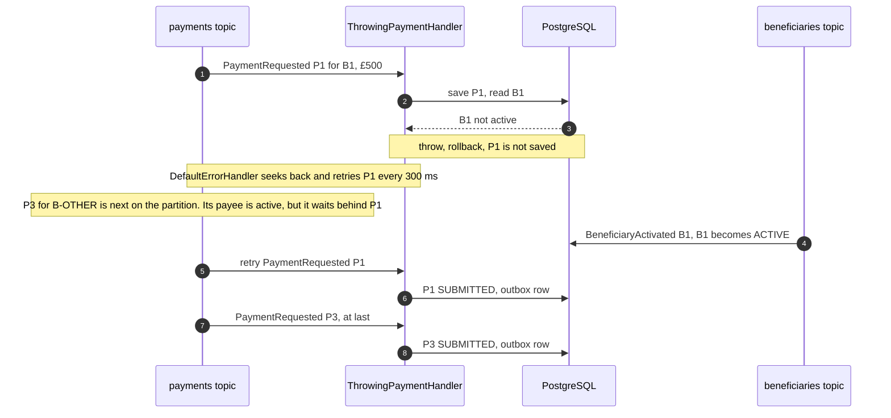
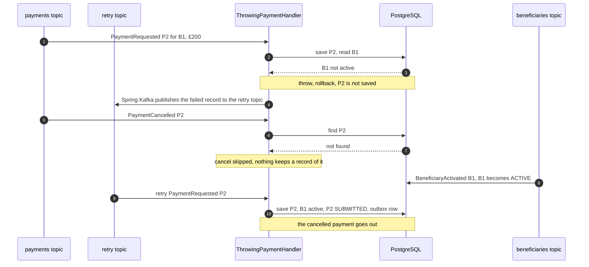
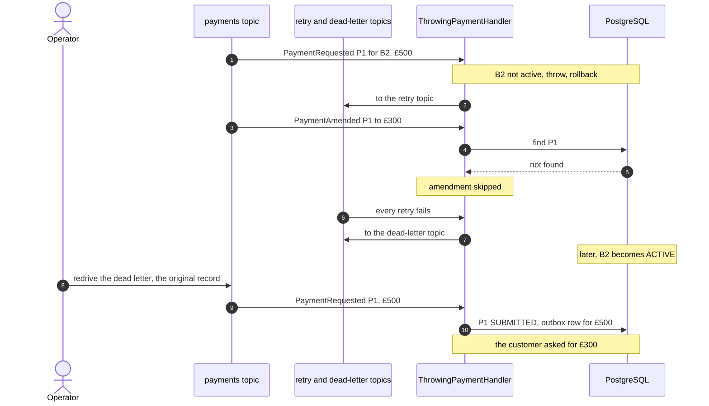
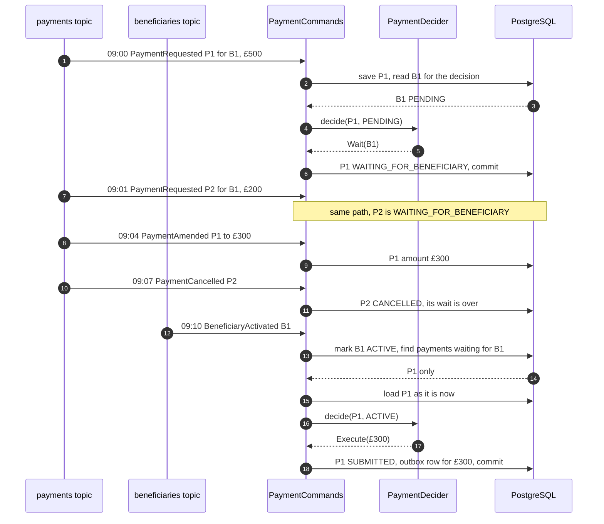
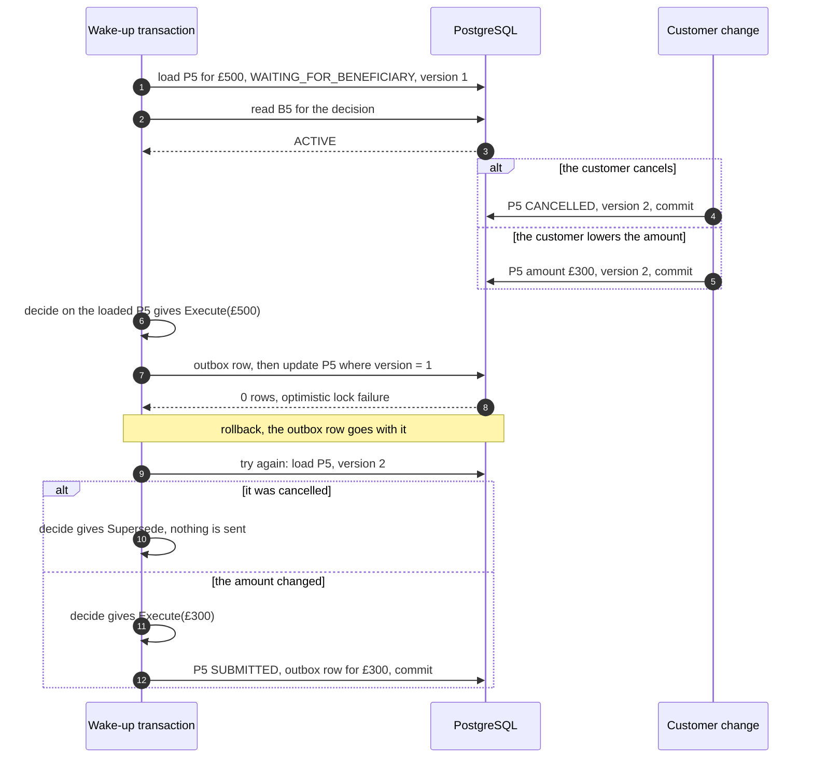
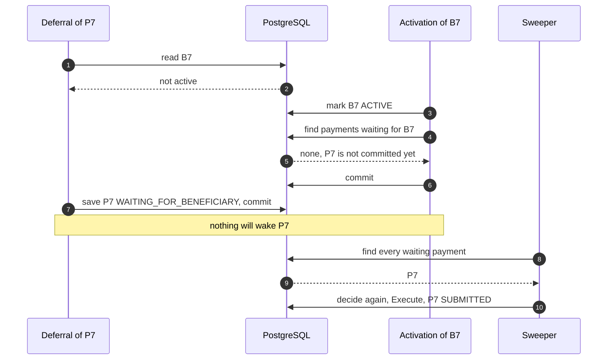
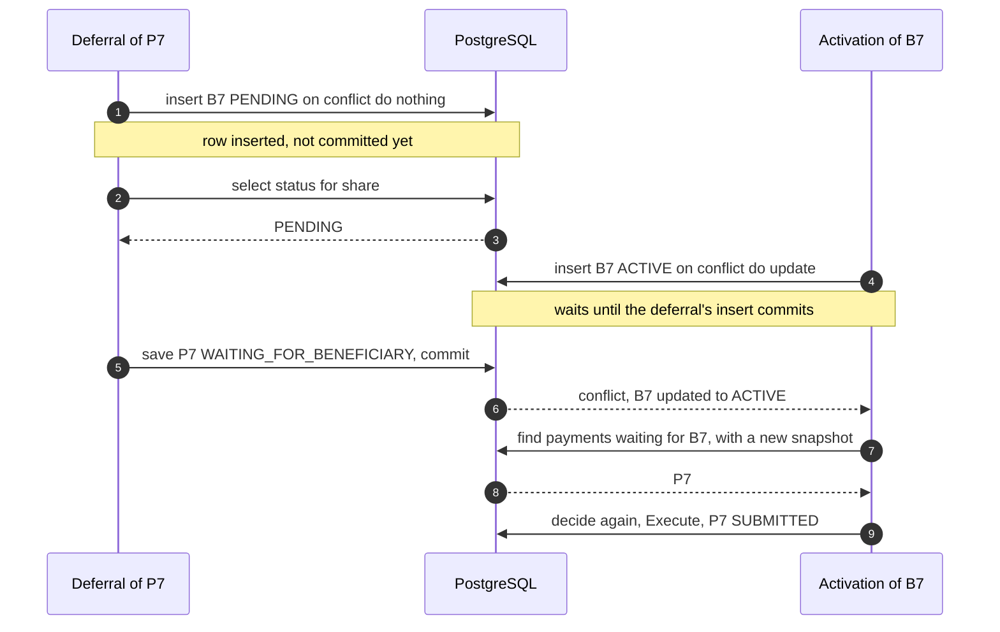
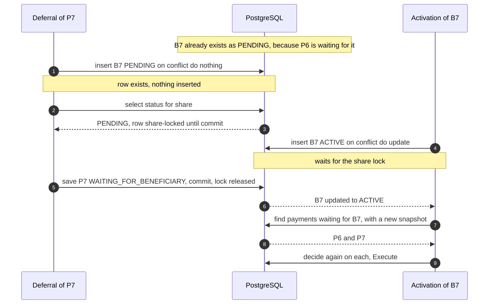

# Don't Replay It, Re-decide It

[](https://github.com/elgamal-ahmed/kafka-deferred-work-recovery/actions/workflows/ci.yml)

Demo code for the talk *Don't Replay It, Re-decide It: Recovering Deferred Work in Kafka and Java*.

It's a small Spring Boot payment service that handles one awkward case three ways: two common
Spring Kafka retry setups, and an alternative. Each scenario below is a test that runs against
real Kafka and PostgreSQL.

> A missing business precondition that can be satisfied later is not a failed execution.
> Store the wait as domain state, wake it on the event that matters, and run the domain
> decision again against current state instead of replaying the original message.

**At a glance.** What happens while a payment waits for its payee to be verified:

| | Blocking retry | Retry topic | Waiting design |
|---|---|---|---|
| Other payments on the partition | Wait behind it | Keep moving | Keep moving |
| The customer cancels | The cancel waits behind the payment | The cancel is lost and the payment is sent | The payment is cancelled and nothing is sent |
| The customer lowers £500 to £300 | The amendment waits behind the payment | The amendment is lost, and a redrive sends £500 | £300 is sent |

**Contents**

1. [The problem](#the-problem)
2. [The usual fix: throw and retry](#the-usual-fix-throw-and-retry)
3. [The alternative: wait, then decide again](#the-alternative-wait-then-decide-again)
4. [What the alternative has to get right](#what-the-alternative-has-to-get-right)
5. [Evidence: every claim and its test](#evidence-every-claim-and-its-test)
6. [Run it](#run-it)
7. [Code map](#code-map)
8. [Deliberately left out](#deliberately-left-out)

## The problem

A customer adds a new payee and pays them straight away. The payee is still being verified, so the
payment service has to hold the payment until it hears the payee is active.

| Topic | Events | Key |
|---|---|---|
| `payments` | `PaymentRequested`, `PaymentAmended`, `PaymentCancelled` | payment id |
| `beneficiaries` | `BeneficiaryActivated` | beneficiary id |

Kafka orders records within a partition, never across topics. So a payment arriving before its
payee is verified is the normal case, not an edge case.

The talk follows one morning. Each test below replays part of it.

| Time | Event |
|---|---|
| 09:00 | P1 requested: £500 to payee B1 |
| 09:01 | P2 requested: £200 to B1 |
| 09:04 | P1 amended to £300 |
| 09:07 | P2 cancelled |
| 09:10 | B1 verified |

The right outcome is P1 sent for £300 and P2 never sent.

## The usual fix: throw and retry

The common Spring Kafka answer treats "payee not verified" as an error. The handler throws, the
transaction rolls back, and Spring's retry machinery tries again later.

```java
// ThrowingPaymentHandler, shortened
Payment payment = payments.save(Payment.requested(...));
if (beneficiaries.read(event.beneficiaryId()) != BeneficiaryStatus.ACTIVE) {
    throw new BeneficiaryNotActiveException(event.beneficiaryId());   // rolls back the save
}
payment.submit();
outbox.paymentSubmitted(payment.id(), payment.amount());
```

Spring Kafka gives two ways to retry. Each one breaks something. In the diagrams, listeners that
only pass an event on are left out.

### Blocking retry stalls the partition

`DefaultErrorHandler` retries the record in place. Order is kept, but every later record on the
partition waits, including a payment whose payee is already active.



Proven by [`BlockingRetryTest`](src/test/java/com/elgamal/payments/throwing/BlockingRetryTest.java).

### A retry topic loses the cancel

`@RetryableTopic` moves the failed record to a retry topic, so the partition keeps moving. The
cancel is now processed first. It finds no payment, because the request was rolled back, and is
skipped. When the payee is verified, the retry succeeds and the cancelled payment goes out.



Proven by [`NonBlockingRetryTest`](src/test/java/com/elgamal/payments/throwing/NonBlockingRetryTest.java).

### A dead-letter redrive sends the old amount

An amendment is lost the same way. When the retries run out, the request lands on the dead-letter
topic. An operator who redrives it later replays the original record, so £500 goes out instead of
£300.



Proven by [`DeadLetterRedriveTest`](src/test/java/com/elgamal/payments/throwing/DeadLetterRedriveTest.java).

**Why not retry the cancel and the amendment too?** In this design a payment is only committed once
it has been submitted, so a retried cancel would still never find an open payment to act on.
Retrying more things doesn't help while the rollback throws the payment away.

## The alternative: wait, then decide again

Every decision has one of three outcomes:

```java
public sealed interface Decision {
    record Execute(BigDecimal amount) implements Decision {}
    record Wait(String beneficiaryId) implements Decision {}
    record Supersede(String reason) implements Decision {}
}
```

And one function makes it, on first delivery and on every wake-up:

```java
// PaymentDecider
public Decision decide(Payment payment, BeneficiaryStatus beneficiary) {
    return switch (payment.status()) {
        case SUBMITTED, CANCELLED -> new Supersede("payment is already " + payment.status());
        case REQUESTED, WAITING_FOR_BENEFICIARY -> beneficiary == BeneficiaryStatus.ACTIVE
                ? new Execute(payment.amount())
                : new Wait(payment.beneficiaryId());
    };
}
```

It never sees the original message. An amendment or a cancel made while the payment waited is
simply part of the current state. Four rules make it work:

- **Don't throw for a missing precondition.** The request and its waiting state commit together.
  The listener only throws for technical failures, and those stay with the retry infrastructure.
- **One decision function.** [`PaymentDecider`](src/main/java/com/elgamal/payments/waiting/PaymentDecider.java)
  is pure, so it's tested without Spring, Kafka or a database.
  [`PaymentCommands`](src/main/java/com/elgamal/payments/waiting/PaymentCommands.java) applies the
  decision with an exhaustive switch, so the compiler checks every outcome is handled.
- **Waiting is explicit state.** `WAITING_FOR_BENEFICIARY`, indexed by `beneficiary_id` so the
  waking event can find it.
- **Wake on the event, sweep as a backstop.** A scheduled sweeper decides again on every waiting
  payment, in case a wake-up was missed.

Here is the 09:00 to 09:10 morning in this design:



Proven by [`WaitingPaymentTest.wakeUpDecidesAgainOnCurrentState`](src/test/java/com/elgamal/payments/waiting/WaitingPaymentTest.java)
and [`PaymentDeciderTest`](src/test/java/com/elgamal/payments/waiting/PaymentDeciderTest.java).

## What the alternative has to get right

Storing a wait and waking it later creates two races. The tests reproduce both deterministically: a
test hook, [`PausingHooks`](src/test/java/com/elgamal/payments/PausingHooks.java), pauses one
transaction at an exact point while the test runs the competing one.

### A customer change lands during a wake-up

A wake-up loads the payment, then the customer cancels or amends it before the wake-up commits.
The payment's `@Version` makes the stale write fail. The outbox row is in the same transaction, so
it rolls back too. The payment is reloaded and the decision is made again on current state.



Proven by [`WaitingPaymentTest.cancelAfterLoadFailsVersionCheckAndSupersedes`](src/test/java/com/elgamal/payments/waiting/WaitingPaymentTest.java)
and [`WaitingPaymentTest.amendAfterLoadFailsVersionCheckAndSendsNewAmount`](src/test/java/com/elgamal/payments/waiting/WaitingPaymentTest.java).

### The lost wakeup

The deferral reads "not active", and the activation commits before the deferral saves its wait.
The activation looks for waiting payments too early, and nothing wakes the payment until the
sweeper runs.



Proven by [`LostWakeupTest`](src/test/java/com/elgamal/payments/waiting/LostWakeupTest.java), with the
fix switched off through `demo.deferral.lock-precondition=false`.

### Closing the lost wakeup

The deferral and the activation take turns on the beneficiary row, in
[`BeneficiaryProjection`](src/main/java/com/elgamal/payments/beneficiary/BeneficiaryProjection.java):

```sql
-- deferral: make sure the row exists, then share-lock it until commit
insert into beneficiary (id, status) values (?, 'PENDING') on conflict (id) do nothing;
select status from beneficiary where id = ? for share;

-- activation: writes the same row, so it waits for any deferral in flight
insert into beneficiary (id, status) values (?, 'ACTIVE') on conflict (id) do update set status = 'ACTIVE';
select id from payment where beneficiary_id = ? and status = 'WAITING_FOR_BENEFICIARY';
```

Each half covers a different case. For a beneficiary the service has never seen, the activation
waits on the deferral's uncommitted insert:



For a beneficiary that is already pending, the activation waits on the share lock:



Both cases rely on READ COMMITTED, where the select after the upsert takes a new snapshot. Under
REPEATABLE READ the first case fails with a serialization error, and the second silently misses the
payment. The application sets READ COMMITTED explicitly, and a test checks it.

Proven by [`LostWakeupFixedTest`](src/test/java/com/elgamal/payments/waiting/LostWakeupFixedTest.java).
To see that each half matters, remove `for share` from `BeneficiaryProjection` and the
pending-beneficiary test fails. Remove the insert and the unknown-beneficiary test fails.

## Evidence: every claim and its test

| Claim | Test |
|---|---|
| Blocking retry keeps order by stopping every later record on the partition | [`BlockingRetryTest`](src/test/java/com/elgamal/payments/throwing/BlockingRetryTest.java) |
| With a retry topic, a cancel overtakes the request, is lost, and the cancelled payment is sent | [`NonBlockingRetryTest`](src/test/java/com/elgamal/payments/throwing/NonBlockingRetryTest.java) |
| The amendment is lost, and redriving the dead letter sends £500 instead of £300 | [`DeadLetterRedriveTest`](src/test/java/com/elgamal/payments/throwing/DeadLetterRedriveTest.java) |
| Waiting as state: the cancel and the amendment apply, and the wake-up sends £300 | [`WaitingPaymentTest`](src/test/java/com/elgamal/payments/waiting/WaitingPaymentTest.java) `wakeUpDecidesAgainOnCurrentState` |
| A cancel during a wake-up fails the version check, and the decision becomes `Supersede` | [`WaitingPaymentTest`](src/test/java/com/elgamal/payments/waiting/WaitingPaymentTest.java) `cancelAfterLoadFailsVersionCheckAndSupersedes` |
| An amendment during a wake-up rolls back the stale send, and £300 goes out | [`WaitingPaymentTest`](src/test/java/com/elgamal/payments/waiting/WaitingPaymentTest.java) `amendAfterLoadFailsVersionCheckAndSendsNewAmount` |
| Without the lock, an activation can miss a waiting payment, and the sweeper catches it | [`LostWakeupTest`](src/test/java/com/elgamal/payments/waiting/LostWakeupTest.java) |
| With the fix, activation waits for the deferral of a beneficiary never seen before | [`LostWakeupFixedTest`](src/test/java/com/elgamal/payments/waiting/LostWakeupFixedTest.java) `activationWaitsForDeferralOfUnknownBeneficiary` |
| With the fix, activation waits for the deferral of a pending beneficiary | [`LostWakeupFixedTest`](src/test/java/com/elgamal/payments/waiting/LostWakeupFixedTest.java) `activationWaitsForDeferralOfPendingBeneficiary` |
| The application runs under READ COMMITTED | [`LostWakeupFixedTest`](src/test/java/com/elgamal/payments/waiting/LostWakeupFixedTest.java) `transactionsRunUnderReadCommitted` |
| The decision rules hold with no Spring or database | [`PaymentDeciderTest`](src/test/java/com/elgamal/payments/waiting/PaymentDeciderTest.java) |

The race tests use controlled thread interleaving, so they're deterministic. The retry tests depend
on the configured backoff, so each of those classes sets its own retry settings. CI runs the whole
suite on Java 21 for every push.

## Run it

**The tests.** You need Java 21, Maven 3.9+ and a running Docker daemon. The first run pulls
`postgres:16-alpine` and `apache/kafka:3.8.0`.

```bash
mvn verify
```

**The application.**

```bash
docker compose up -d
mvn spring-boot:run -Dspring-boot.run.arguments=--demo.design=waiting
```

`demo.design` picks the consumer design: `blocking`, `retry-topic` or `waiting`. Each design uses
its own topics, for example `waiting.payments` and `waiting.beneficiaries`.

## Code map

```
src/main/java/com/elgamal/payments
├── events        DomainEvent (sealed), JSON codec, publisher
├── payment       Payment aggregate with @Version
├── beneficiary   local beneficiary projection and its listener
├── throwing      throw and let Kafka retry: blocking and @RetryableTopic listeners
├── waiting       save the wait as state: the decision, wake-up and sweeper
└── support       outbox, dead letters, demo journal, test seam
```

To read the code in the order of the talk:

1. [`events/DomainEvent`](src/main/java/com/elgamal/payments/events/DomainEvent.java): the four events.
2. [`throwing/ThrowingPaymentHandler`](src/main/java/com/elgamal/payments/throwing/ThrowingPaymentHandler.java): the usual fix.
3. [`waiting/Decision`](src/main/java/com/elgamal/payments/waiting/Decision.java) and [`waiting/PaymentDecider`](src/main/java/com/elgamal/payments/waiting/PaymentDecider.java): the decision.
4. [`waiting/PaymentCommands`](src/main/java/com/elgamal/payments/waiting/PaymentCommands.java): save, wake, decide again, sweep.
5. [`beneficiary/BeneficiaryProjection`](src/main/java/com/elgamal/payments/beneficiary/BeneficiaryProjection.java): the lost-wakeup fix.

## Deliberately left out

- **The outbox relay.** Rows are written in the same transaction as the state change. Publishing
  them, by polling or CDC, is a separate and well-known concern. A relay can deliver an event more
  than once, so whatever consumes `PaymentSubmitted` must ignore duplicates, for example by payment
  id. The payment's `@Version` only makes sure that one transaction commits the change.
- **Kafka transactions.** The throwing designs use a plain database transaction. Spring Kafka does
  not support non-blocking retries with container transactions
  ([docs](https://docs.spring.io/spring-kafka/reference/3.3/retrytopic.html)).
- **Timeouts.** A real waiting payment needs an end, such as a deadline or a beneficiary-rejected
  event. The demo leaves it out to keep the decision to two inputs.
- **Multiple partitions and consumers.** One partition per topic keeps the ordering effects easy
  to see. The problems don't go away with more partitions; they only become harder to observe.
